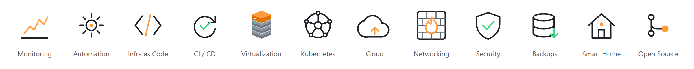
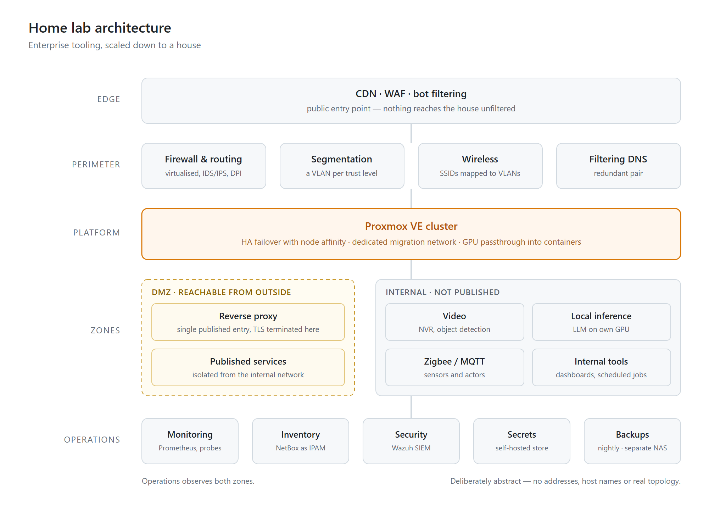

# Same tools, smaller blast radius

<picture>
  <source media="(prefers-color-scheme: dark)" srcset="github-header-dark.png">
  
</picture>

Home lab enthusiast who turned the hobby into a career. I was running servers at
home long before anyone paid me for it; today I'm a systems administrator with a
decade of site reliability engineering and IT security behind me — and the lab is
still where I try things first.

**Currently:** SAP Basis by day; by night keeping the Proxmox VE integration for
Home Assistant in shape.

Infrastructure automation, monitoring, and making things observable — at work and
at home, to the same standards.

I prefer open source wherever it does the job, and I try to give back rather than
just consume: fixes and features go upstream instead of living in a private fork,
and I sponsor projects I rely on.

## Projects

| | |
|---|---|
| **[rtsp2unifi-protect](https://github.com/mZ738/rtsp2unifi-protect)** · author, released (v2.2.0, container image) | Turns any RTSP stream into a virtual Onvif camera for UniFi Protect — audio, motion events from MQTT, Prometheus metrics, offline start. Written for two baby monitors Protect would not take |
| **[Proxmox VE integration for Home Assistant](https://github.com/dougiteixeira/proxmoxve)** · maintainer | New features are developed and tested in my fork [proxmoxve-integration](https://github.com/mZ738/proxmoxve-integration) before they go upstream — that repo is the beta channel if you want to try them early |
| **[aioproxmox](https://github.com/CoMPaTech/aioproxmox)** · contributor | Async Python client for the Proxmox VE API, the library underneath the integration. Changes are worked out in my fork [mZ738/aioproxmox](https://github.com/mZ738/aioproxmox) and go upstream |

## Skills

| | |
|---|---|
| **Currently** | SAP Basis (HANA, S/4HANA, ERP) · Prometheus · Grafana · Microsoft SQL Server · PowerShell · Python · Bash |
| **Home lab** | Proxmox VE · Home Assistant · Wazuh · NetBox · GitLab CI · OpenTofu · Zigbee / MQTT · Frigate · go2rtc · Onvif / UniFi Protect · firewall with IDS/IPS · encrypted filtering DNS |
| **Also experienced with** | Kubernetes · Google Kubernetes Engine · Terraform · Google Cloud Platform · CI/CD · SRE practices · information security · vulnerability management · Node.js |

## The home lab

<picture>
  <source media="(prefers-color-scheme: dark)" srcset="homelab-dark.png">
  
</picture>

A multi-node Proxmox VE cluster with HA failover, a virtualised firewall routing a
segmented VLAN network, and Home Assistant tying the house together.

Enterprise tooling, scaled down to a house:

- **Wazuh** as a SIEM, with agents reporting from every host
- **NetBox** as IPAM and inventory, feeding Prometheus service discovery automatically
- **Self-hosted GitLab with CI on every push** — documentation, playbooks and infrastructure code live in one repository; pipelines lint, validate and secret-scan before anything merges, and the DNS cluster is managed with OpenTofu
- **One camera pipeline for everything** — go2rtc pulls each camera once; a virtual Onvif camera I wrote feeds UniFi Protect, Frigate detects on a GPU passed through into a container, Home Assistant turns detections into Protect events
- **Built to lose a node** — cluster HA failover with affinity rules over a dedicated migration network, encrypted redundant DNS (DoT/DoH/DoQ with failover VIPs), and a self-hosted secret store so no credentials sit in config files

Most of what I publish here started as something I needed there first.

Reach me on [LinkedIn](https://de.linkedin.com/in/marvinzetzsche).
